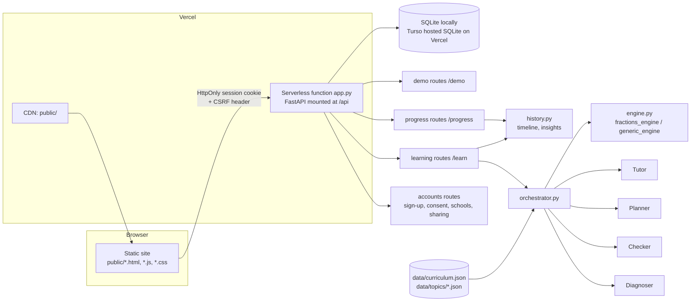
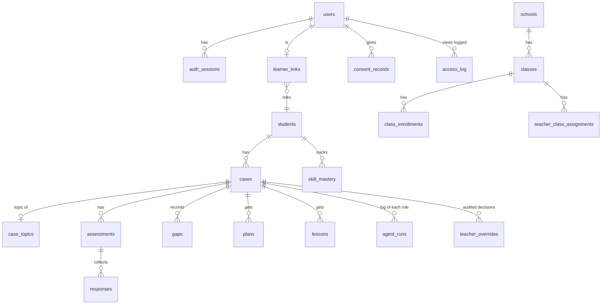
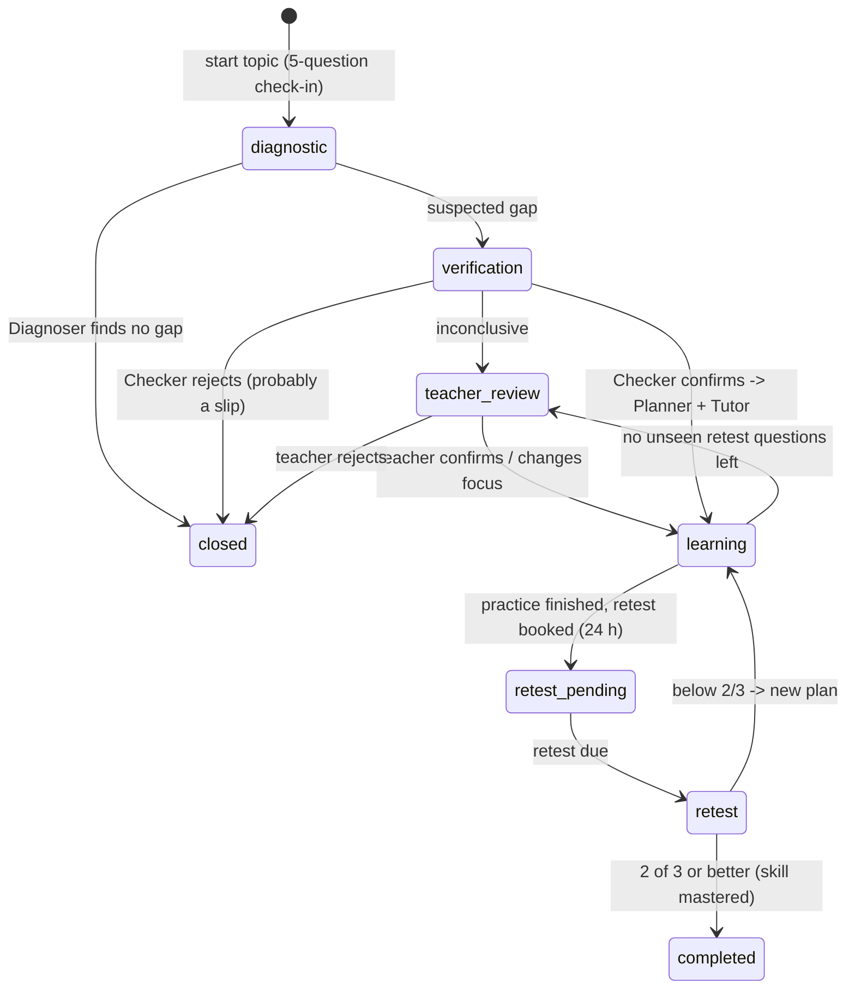

# ELEVIA: Technical documentation

PRASUNEX Innovathon 2026, Round 3 (Prototype Development & Demonstration). Status as of 23 November 2026, code on branch `six-month-demo` (pull request #3). Every number in this document comes from a run that was actually executed; see section 17.

---

## 1. Project overview

ELEVIA is a working web prototype that finds the *misconception* behind a student's wrong answers, **checks that misconception with new questions before teaching anything**, teaches the missing step, and later retests on questions the student has never seen.

- **Coverage:** 5 subjects (Mathematics, Science, English, Social Science, Computer Science), 26 playable topics, 58 skills, 86 named misconception patterns, 1,019 validated questions and 55 lessons.
- **Users:** students, parents, teachers and school admins, each with real accounts and role-based access.
- **Demo:** a fictional Class 9 with six months of learning history, produced by running the real workflow.

**Principle:** *verify before you teach.* A suspected misconception is a hypothesis until new evidence supports it.

## 2. Problem statement

- **A mark says *that*, not *why*.** A wrong answer tells a teacher that a student is stuck, not why. A student who writes 1/2 + 1/3 = 2/5 is following a rule (add the tops, add the bottoms), not making a random error.
- **Common responses go wrong.** Marking it wrong and re-teaching the chapter, or guessing a weakness from a single mistake, either misses the real gap or wastes time teaching what the student already knows.
- **The gap is often earlier.** Trouble adding fractions can come from finding common denominators, a prerequisite skill.
- **Teachers can't do this one by one.** A teacher with 40 students can't run a diagnostic conversation with each of them.

## 3. Proposed solution

Four roles take turns on every case. Each has one job and hands off to the next.

| Role | Job | Decides by |
|---|---|---|
| **Diagnoser** | Proposes a *possible* gap from the check-in answers | Matching answers to named misconception patterns. Output is always "suspected" |
| **Checker** | Verifies the gap with 2 new questions; later runs the retest | Fixed rules (section 10). The only role that can mark a skill mastered |
| **Planner** | Chooses where the lesson starts | Walks prerequisites in the skill map. **Refuses unverified gaps** |
| **Tutor** | Lesson, worked examples, hints, practice | Authored content; maths computed exactly |

A teacher resolves the cases the Checker can't decide, and can change the focus. Every override needs a reason and is logged.

> **About "agentic".** The four roles are **deterministic, rule-based components** coordinated by an orchestrator. They are **not autonomous LLM agents**, and no AI model makes any decision. An optional module can ask an LLM to *reword* the Diagnoser's hypothesis or the Tutor's note. Its output is validated, and template text is used whenever no model is configured (the default, and the state of the deployed site). It has only been tested with simulated model responses.

## 4. Target users

| User | What they do in ELEVIA |
|---|---|
| Student (school student with a class code, individual student with parent consent, or independent learner 18+) | Check-ins, double-checks, lessons, practice, retests; dashboard with next step, six-month timeline, subject progress, skill map |
| Teacher | Sees only students in classes assigned to them: class overview and insights, review queue, evidence, confirm/reject/change focus with a reason |
| Parent | Plain-language view of their own child, limited by the consent they gave |
| School admin | Creates classes, invites teachers, manages enrolments; no access to learning data |

## 5. System architecture

- **One deployable app.** `app.py` is the only server process: one Vercel serverless function. Static files are served from the CDN.
- **Two backends, one schema.** SQLite runs locally; Turso is used on Vercel through a small HTTP connector (`backend/turso.py`). Without Turso, the function falls back to a temporary `/tmp/elevia.db`.
- **Curriculum as data.** Topics are authored as Python in `scripts/curriculum/*.py`. `scripts/build_curriculum.py` compiles them to JSON and validates every item at build time.

## 6. Technology stack

| Layer | Technology |
|---|---|
| Backend | Python 3.13, FastAPI (≥ 0.115), Pydantic 2, Uvicorn, httpx, python-dotenv |
| Database | SQLite (local), Turso / libSQL over HTTP (deployed) |
| Frontend | Vanilla JavaScript, HTML, CSS; no framework, no build step; self-hosted fonts (Nunito, Rubik Dirt, Kalam) |
| Hosting | Vercel: Python serverless function + CDN |
| Testing | pytest (API, engine, rules, data consistency), Playwright with headless Chromium (browser end-to-end) |
| Security headers | Content Security Policy (`script-src 'self'`), `X-Frame-Options: DENY`, `nosniff`, `no-referrer`, set in `vercel.json` |

## 7. Database architecture

32 tables in total: 11 for learning (`backend/db.py`) and 21 for accounts and the demo (`backend/accounts/schema.py`). All are created with `CREATE TABLE IF NOT EXISTS`. Round 3 only **added** tables; nothing was altered or dropped.

| Group | Tables |
|---|---|
| Learning | `students`, `cases`, `case_topics`, `assessments`, `responses`, `gaps`, `plans`, `lessons`, `skill_mastery`, `agent_runs`, `teacher_overrides` |
| Accounts | `users`, `auth_sessions`, `email_tokens`, `student_profiles`, `parent_profiles`, `teacher_profiles`, `learner_links` |
| Schools | `schools`, `classes`, `school_memberships`, `referral_codes`, `class_enrollments`, `teacher_class_assignments` |
| Consent and privacy | `parent_student_links`, `consent_records`, `share_grants`, `access_log` |
| Platform | `rate_events`, `email_outbox` |
| Demo | `demo_registry` (which rows the demo created), `demo_profiles` (student code, reference date) |

`agent_runs` stores every role's input, output and timestamp. It is the audit trail behind the timeline and the teacher's evidence view.

## 8. Diagnoser, Checker, Planner and Tutor

| Role | Code | Input → output |
|---|---|---|
| Diagnoser | `backend/agents/diagnoser.py` | 5 check-in responses → `has_gap`, primary misconception, gap skill, evidence, hypothesis text |
| Checker | `backend/agents/checker.py` | 2 double-check responses → verdict `confirmed` / `rejected` / `inconclusive` with reason; books retests; 3 retest responses → pass/fail and skill status |
| Planner | `backend/agents/planner.py` | A verified gap + skill map + mastery → focus skill and steps (refuses unverified gaps) |
| Tutor | `backend/agents/tutor.py` | Plan → lesson (big idea, steps, sense check, worked examples, a personal note quoting the student's answer), practice, hints |
| Orchestrator | `backend/orchestrator.py` | Moves each case through its stages and records every role run in `agent_runs` |

## 9. Complete learning workflow

- **One case per topic.** A student can have one active case per topic, so a 24-hour wait in one topic doesn't block another.
- **Saved as it goes.** Progress is saved after every answer.

## 10. Misconception detection and verification

- **Patterns.** Each question stores the wrong answers a known misconception produces, e.g. `1/2 + 1/3 → 2/5` means *adds numerators and denominators*. In maths these are computed by rule; in Computer Science the right output is obtained by running the snippet when the bank is built.
- **Diagnoser.** Counts which misconceptions the check-in answers match, then picks the primary one and the skill it points to. A single match is treated as a possible slip; the hypothesis is always labelled *suspected*.
- **Checker.** Asks two new questions aimed at that misconception, then applies the rule in `checker.py`:

| Double-check responses | Verdict |
|---|---|
| At least one answer repeats the misconception, and such answers are at least as many as the right answers | **confirmed** |
| No answer repeats the misconception and none is a different mistake (all right) | **rejected**: probably a slip |
| Anything else (e.g. a *different* mistake) | **inconclusive**: sent to a teacher |

## 11. Skill mapping and learning plans

- **Skill map.** 58 skills, each with prerequisites, including links across topics: e.g. *longitude and time difference* requires *what latitude and longitude measure*.
- **Planner.** Starts from the gap skill and walks back through its prerequisites, preferring an earlier skill that is not secure. It produces a focus skill and steps.
- **Teacher.** Can change the focus with a reason. The change is logged and the Tutor rebuilds the lesson.
- **Limitation.** The plan follows one prerequisite chain; it is not an optimised multi-skill learning path.

## 12. Lessons and retests

- **Lesson content.** Each lesson has a big idea, steps, a sense check and worked examples. It opens with a personal note quoting the student's own wrong answer.
- **Practice.** Gives instant feedback, hints and full solutions. **Practice answers never count towards progress.** At least two practice questions are required before finishing.
- **Retest booking.** When practice is finished, the Checker books **3 unseen questions** for **24 hours later** (`RETEST_DELAY_HOURS`). The server enforces the delay. A demo shortcut (`ALLOW_EARLY_RETEST`, on by default) lets a presenter start early, and every use is logged as `early_retest_override`.
- **Retest result.** **2 of 3** (and at least 2/3) marks the skill mastered. Below that, the gap stays open and the Planner makes a new plan. If no unseen questions are left (each skill has 6 retest questions), the case goes to a teacher.

## 13. Student dashboard

Route `#/learn`, from `/api/learn/dashboard` and `/api/learn/history`:

- **"What to do next"**: one recommended action. The priority is a due retest, then work in progress, then a booked retest, then a recommended new topic.
- **Continue learning**: every open case with its stage. Also shown: upcoming retests and gaps being worked on.
- **Six-month timeline**: monthly bars of answers checked, with % right, skills mastered, failed retests and confirmed gaps, plus a full table view.
- **Progress by subject** (5 subjects) and a **skill map** of every playable skill: mastered, being worked on, checked, or not started.
- **Learning history**: every check-in, verdict, lesson, retest and teacher decision, filterable by subject.

All figures come from `backend/history.py`, which reads only stored records. Tests check that the monthly figures add up to the totals, and that the totals match the dashboard header and the database.

## 14. Teacher portal

From `/api/progress/students` and `/api/progress/students/{id}`:

- **Review queue**: cases waiting for a teacher, each with the reason (e.g. "Double-check was mixed", "No unseen retest questions left").
- **Class overview**: students, confirmed gaps open, upcoming retests, skills mastered recently, students needing attention (with reasons), a subject table and monthly class activity.
- **Class insights**:
  - topics causing difficulty;
  - most frequent misconceptions (counted by distinct students);
  - repeated unsuccessful retests;
  - most improved (a retest passed after a failed one);
  - recently mastered.
- **Student detail**: six-month timeline and skill map, then each topic with the Diagnoser's hypothesis, check-in answers, double-check answers and the Checker's verdict, retest history and the case audit.
- **Review**: confirm, reject, change focus or add a note. A reason of 5–500 characters is required. Each decision is saved to `teacher_overrides` and shown in the case audit, the student's history and the **intervention history**.
- **Scope**: teachers see only students in classes assigned to them; school admins can't read learning data.

## 15. Demo environment and sample data

A fictional **Class 9 A at ELEVIA Demonstration School (2026-27)**:

| Account | Role | History (from a fresh seed, reference date 23 Nov 2026) |
|---|---|---|
| Riya Sharma, DEMO-09-001 | Student, Grade 9 | 16 check-ins, 141 graded answers (+49 practice); 9 gaps confirmed, 3 rejected, 2 inconclusive; 14 lessons; retests 8 passed, 3 not; 8 skills mastered; 3 teacher decisions |
| Arjun Patel, DEMO-09-002 | Student | Integers retest failed twice, then handed to the teacher; a mixed fractions double-check |
| Kabir Singh, Meera Nair, Zoya Khan | Students | Strong; steady with one teacher rejection; joined in month 4 |
| Dev Kapoor | New learner (19) | No history, for a live walkthrough |
| Ananya Mehta | Class 9 teacher | Reviews, notes and a change of focus spread over the six months |
| Sunita Sharma (and 4 other parents) | Parents | Each sees only their own child |
| Kavita Menon | School admin | Classes and enrolments only |

Class totals: 34 learning cases, 373 answers, 5 saved teacher decisions.

**How it is made.** `scripts/demo.py` drives the **real HTTP routes** while a seed-only simulated clock (`backend/clock.py`) is set to each visit's date.
- **Real workflow:** sign-up, consent, teacher approval, check-ins, double-checks, lessons, practice, retests and teacher reviews all happen through the product. Only the answers are simulated.
- **Delays honoured:** retests start only when due, and 0 early-retest overrides are used.
- **Checked as it goes:** each step asserts the stage the workflow reached, so a rule change stops the seed instead of producing an inconsistent story.
- **Deterministic:** the same reference date always produces the same history.
- **Labelled:** every demo dashboard shows a *Demonstration account* banner explaining that the history is synthetic.

**Access.**
- **Students:** Riya, Dev and Arjun open with one click from **Try demo** when `ELEVIA_DEMO_MODE=1`.
- **Teacher:** the teacher view opens only with the judges' access code (`ELEVIA_DEMO_TEACHER_CODE`, a server secret).
- **Parents and admin:** never one-click.
- **Passwords:** no demo password is stored in the repository (`ELEVIA_DEMO_PASSWORD`, or a random one printed once).

**Reset.** `python scripts/demo.py reset` deletes only rows listed in `demo_registry`, then seeds again. A test confirms that a real user created alongside the demo survives.

## 16. Security and privacy

- **Passwords**: hashed with scrypt; repeated failed logins for an account are blocked for 15 minutes; unknown accounts take the same time to answer.
- **Sessions**: HttpOnly, SameSite=Lax cookie (Secure on HTTPS); 7-day lifetime and 24-hour idle timeout; a CSRF header is required on state-changing requests.
- **Rate limits** (stored in `rate_events`) on failed logins, outgoing emails (verification, password reset, consent), class-code guesses, sharing invitations, demo logins (60 per 10 minutes per IP) and wrong teacher access codes (10 per 10 minutes).
- **Consent**: parent consent for under-18s, with scopes (progress, assessments, activity); school students join with a class code and teacher approval.
- **Access control and audit**: every progress view is checked and written to `access_log`. Teachers see their own classes only. Misconception names are shown only with the `gaps` scope.
- **Content Security Policy**: `script-src 'self'`; all text is inserted with `textContent`; fonts are self-hosted.
- **Computer Science safety**: student input is **never executed**; it is compared as text.
- **Not health data**: ELEVIA identifies academic gaps only. It is not a clinical or psychological assessment.

## 17. Testing methodology and results

All results below were run on 23 November 2026 on branch `six-month-demo`.

| Suite | Command | Result |
|---|---|---|
| Automated tests (local SQLite) | `python -m pytest -q` | **202 passed, 0 failed** |
| Same tests through the Turso connector | `ELEVIA_TEST_TURSO=1 python -m pytest -q` | **202 passed, 0 failed** |
| Curriculum build validation | `python scripts/build_curriculum.py` | 5 subjects, 26 topics, 58 skills, 86 misconceptions, 1,019 questions, 55 lessons, all valid |
| Browser end-to-end (headless Chromium) | `python scripts/e2e_browser.py` | **26 of 26 checks passed, 0 console errors** |

The 202 tests cover:
- the full journey **and** a rejected-gap journey for every non-fraction topic (parametrised over 25 topics), plus the fraction journeys;
- the role rules;
- accounts, consent, role access, demo login, the teacher access code and reset;
- **data consistency** (every dashboard figure backed by records);
- determinism, and that the simulated clock can't be changed by any request.

The browser run covers:
- the student journey (check-in → double-check → lesson → practice → retest → result);
- Riya's six-month history (the monthly table adds up to the dashboard totals);
- the teacher journey (access code → overview → flagged case evidence → decision with a reason → visible in the history);
- the parent's restricted view;
- phone and tablet layouts, no JavaScript, and reduced motion.

Detailed list: [`../TEST_RESULTS.md`](../TEST_RESULTS.md).

## 18. Deployment architecture

- **Platform.** Vercel project `frontend-pmvi`: `app.py` runs as a Python serverless function (`maxDuration` 30 s), and `public/` is served from the CDN.
- **Branch deploys.** Pushing to `main` deploys production; other branches get preview deployments.
- **Configuration.**
  - **Required for persistence:** `TURSO_DATABASE_URL` and `TURSO_AUTH_TOKEN`. Both are now set for Production, Preview and Development.
  - **For the demo:** `ELEVIA_DEMO_MODE` and `ELEVIA_DEMO_TEACHER_CODE`. Not set yet.
  - **Optional:** `RETEST_DELAY_HOURS`, `ALLOW_EARLY_RETEST`, `EMAIL_MODE=smtp` with `SMTP_*`, and the `LLM_*` settings.

**Verified status (23 Nov 2026):**

| Target | Status |
|---|---|
| Preview of `six-month-demo` | Builds. In a browser: `/api/health` 200; 5 subjects, 26 topics, 1,019 questions; landing page renders; demo reports "off" (expected) |
| Preview access | Protected by Vercel Authentication: visitors must be logged in to the Vercel team. **Judges can't open preview links** |
| Production `frontend-pmvi.vercel.app` | Serves the **old `main` build (10 Nov)**. Its API returns **500** on every call. Fixed by merging the round 3 pull requests and redeploying |

## 19. Known limitations

- **No classroom evaluation.** There are no learning-outcome claims.
- **Deterministic rules**, and a simple mastery rule (2 of 3); no probabilistic knowledge tracing.
- **Fixed question banks.** Repeated failures on one skill end in teacher review.
- **Partial curriculum.** 26 topics; many Class 9 chapters (e.g. democracy, the French Revolution, electricity, reading comprehension) are listed as "coming soon".
- **Answer formats.** Multiple choice, exact numbers and accepted words only; no essay marking. Computer Science is predict-the-output only.
- **Synthetic demo data.** The six-month history is synthetic, and the demo accounts are shared: reset before judging.
- **Optional AI wording** is untested with a real model.
- **No reminders or notifications.** Parent consent is email ownership plus a declaration, not verifiable parental consent.
- **Production isn't serving round 3 yet** (section 18).

## 20. Future development roadmap

See [`ROUND3_FUTURE_ROADMAP.md`](ROUND3_FUTURE_ROADMAP.md). In brief:
- **Short term:** a classroom pilot with baseline measures, the "coming soon" topics, retest reminders, and teacher authoring of questions.
- **Medium term:** a validated mastery model (e.g. Bayesian Knowledge Tracing), richer diagnosis, parent engagement, Hindi and Marathi, accessibility audit.
- **Long term:** institutional onboarding with verifiable consent, scale-out and integrations.

---

*AI-assisted development: much of the code, curriculum scripts, tests and documentation was written with an AI coding assistant (Anthropic's Claude, via Claude Code) under the team's direction and review. Commits it contributed to carry a `Co-Authored-By: Claude` trailer; history has not been rewritten.*
